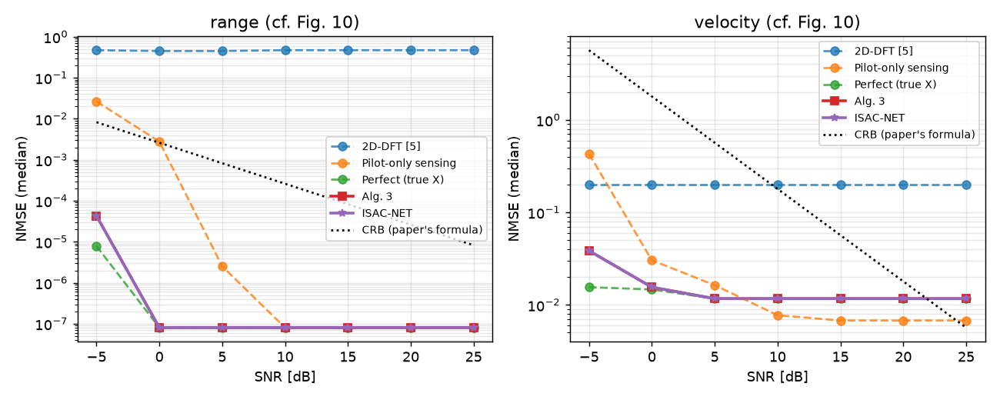
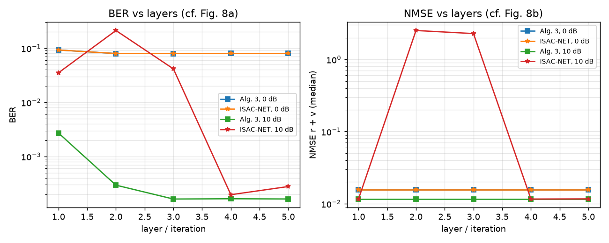
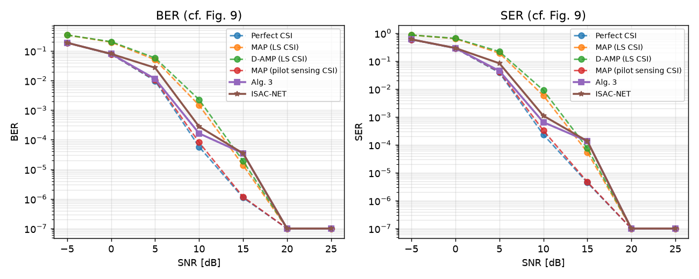

# ISAC-NET run status

**Updated:** 2026-10-26 12:27 AM IST

_If this time stops moving, the Mac run has stopped (or the Mac is offline/asleep)._

**State:** RUNNING (pid 45960, elapsed 03:59:25)

**Current step:** `scripts/train_isacnet.py`

## Stages started
```
== baselines (NumPy, on 12 CPU cores) ==
== train ISAC-NET (inner4) ==
== evaluate (inner4) ==
== train ISAC-NET (literal) ==
```

## Errors
```
(none)
```

## Last log lines
```
[snr 15] step 240/300 train 1.4182 val 0.2503 (best 0.1720, Alg. 3 1.2249) (4474s)
[snr 10] step 240/300 train 1.1452 val 0.5045 (best 0.3811, Alg. 3 1.2953) (4482s)
[snr 5] step 240/300 train 1.3494 val 0.1627 (best 0.0608, Alg. 3 0.6157) (4482s)
[snr 0] step 260/300 train 1.6236 val 1.6453 (best 0.8037, Alg. 3 1.2844) (4848s)
[snr 20] step 260/300 train 8.8040 val 0.7526 (best 0.1505, Alg. 3 0.4002) (4848s)
[snr 25] step 260/300 train 0.5226 val 0.1632 (best 0.0180, Alg. 3 0.2924) (4851s)
[snr 15] step 260/300 train 0.8751 val 0.2864 (best 0.1720, Alg. 3 1.2249) (4852s)
[snr 10] step 260/300 train 0.5927 val 0.4406 (best 0.3811, Alg. 3 1.2953) (4861s)
[snr 5] step 260/300 train 1.5221 val 0.0622 (best 0.0608, Alg. 3 0.6157) (4862s)
[snr 20] step 280/300 train 1.3568 val 0.9188 (best 0.1505, Alg. 3 0.4002) (5229s)
[snr 0] step 280/300 train 1.3372 val 1.5622 (best 0.8037, Alg. 3 1.2844) (5229s)
[snr 25] step 280/300 train 1.1135 val 0.1641 (best 0.0180, Alg. 3 0.2924) (5232s)
[snr 15] step 280/300 train 2.3582 val 0.2896 (best 0.1720, Alg. 3 1.2249) (5233s)
[snr 10] step 280/300 train 0.6288 val 0.5267 (best 0.3811, Alg. 3 1.2953) (5240s)
[snr 5] step 280/300 train 1.0546 val 0.0622 (best 0.0608, Alg. 3 0.6157) (5244s)
```

## Result files
```
Oct 25 22:55 results/fig_gpu_inner4_8.png
Oct 25 22:55 results/fig_gpu_inner4_10.png
Oct 25 22:55 results/fig_gpu_inner4_9.png
Oct 25 22:54 results/isacnet_gpu_inner4.json
Oct 25 22:29 results/eta_gpu_inner4.json
Oct 25 20:38 results/baselines_full_gpu.png
Oct 25 20:38 results/baselines_full_gpu.json
```

### fig_gpu_inner4_10.png


### fig_gpu_inner4_8.png


### fig_gpu_inner4_9.png

