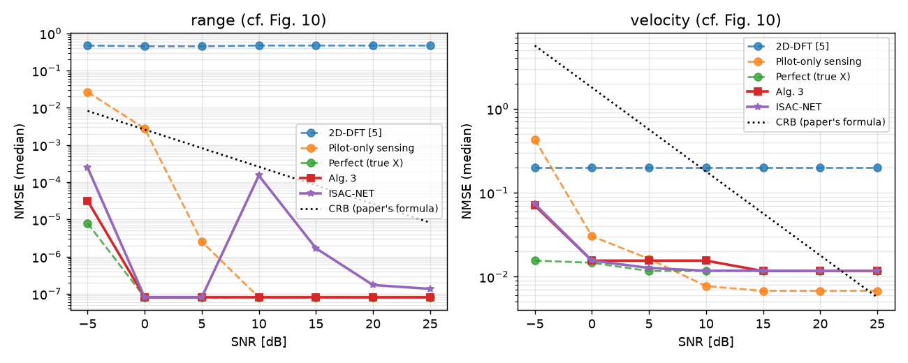
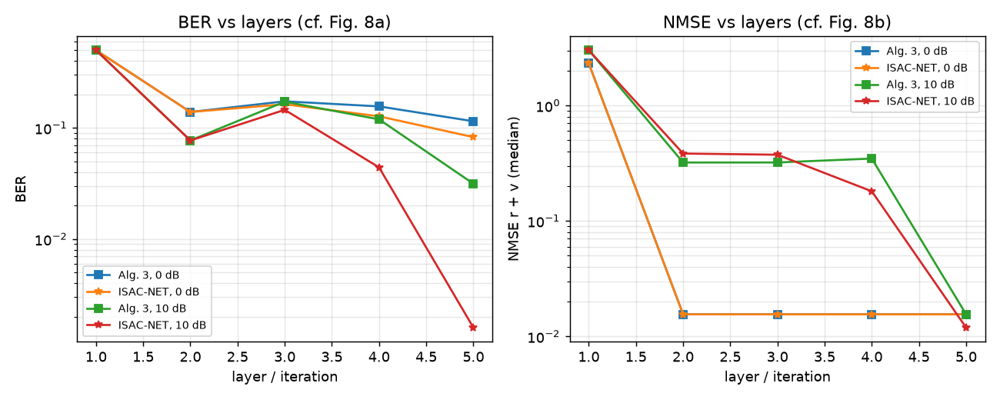
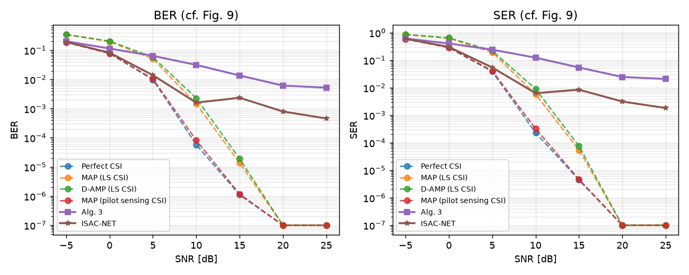

# ISAC-NET run status (joint-snr: literal, one eta for all SNRs)

**Updated:** 2026-10-26 06:29 PM IST

_If this time stops moving, the Mac run has stopped (or the Mac is offline/asleep)._

**State:** FINISHED

## Stages started
```
== train ISAC-NET (literal, one eta for all SNRs) ==
== evaluate ==
```

## Errors
```
(none)
```

## Last log lines
```
alg3     SNR   0.0 BER 1.15e-01 SER 4.06e-01 NMSE r 7.6e-02 (med 8.1e-08) v 5.4e-01 (med 1.6e-02)
alg3     SNR   5.0 BER 6.42e-02 SER 2.42e-01 NMSE r 5.5e-02 (med 8.1e-08) v 4.9e-01 (med 1.6e-02)
alg3     SNR  10.0 BER 3.15e-02 SER 1.24e-01 NMSE r 1.2e-01 (med 8.1e-08) v 1.2e+00 (med 1.6e-02)
alg3     SNR  15.0 BER 1.36e-02 SER 5.44e-02 NMSE r 1.4e-01 (med 8.1e-08) v 8.5e-01 (med 1.2e-02)
alg3     SNR  20.0 BER 6.14e-03 SER 2.45e-02 NMSE r 9.5e-02 (med 8.1e-08) v 8.0e-01 (med 1.2e-02)
alg3     SNR  25.0 BER 5.20e-03 SER 2.08e-02 NMSE r 5.3e-02 (med 8.1e-08) v 4.1e-01 (med 1.2e-02)
isacnet  SNR  -5.0 BER 1.91e-01 SER 6.01e-01 NMSE r 1.5e-01 (med 2.5e-04) v 1.1e+00 (med 7.3e-02)
isacnet  SNR   0.0 BER 8.26e-02 SER 3.03e-01 NMSE r 6.7e-02 (med 8.1e-08) v 7.4e-01 (med 1.6e-02)
isacnet  SNR   5.0 BER 1.40e-02 SER 5.44e-02 NMSE r 5.7e-02 (med 8.1e-08) v 4.5e-01 (med 1.3e-02)
isacnet  SNR  10.0 BER 1.60e-03 SER 6.31e-03 NMSE r 3.8e-02 (med 1.5e-04) v 3.0e-01 (med 1.2e-02)
isacnet  SNR  15.0 BER 2.35e-03 SER 8.49e-03 NMSE r 3.1e-02 (med 1.7e-06) v 1.7e-01 (med 1.2e-02)
isacnet  SNR  20.0 BER 7.96e-04 SER 3.14e-03 NMSE r 2.0e-02 (med 1.7e-07) v 1.7e-01 (med 1.2e-02)
isacnet  SNR  25.0 BER 4.57e-04 SER 1.83e-03 NMSE r 1.3e-02 (med 1.4e-07) v 6.5e-02 (med 1.2e-02)
wrote results/fig_joint_literal_{8,9,10}.png
done: results/fig_joint_literal_*
```

## Result files
```
Oct 26 18:28 results/fig_joint_literal_8.png
Oct 26 18:28 results/fig_joint_literal_10.png
Oct 26 18:28 results/fig_joint_literal_9.png
Oct 26 18:28 results/isacnet_joint_literal.json
Oct 26 18:02 results/eta_joint_literal.json
```

### fig_joint_literal_10.png


### fig_joint_literal_8.png


### fig_joint_literal_9.png

