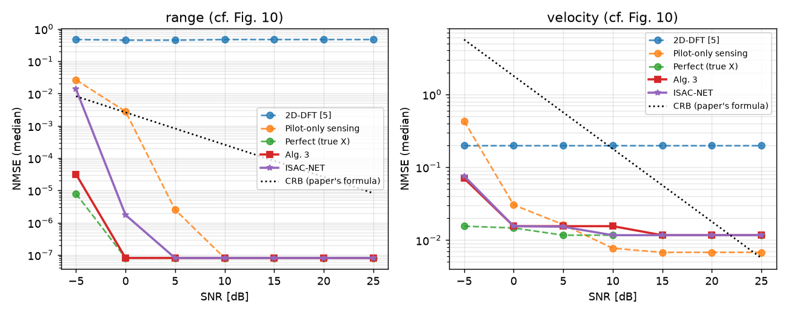
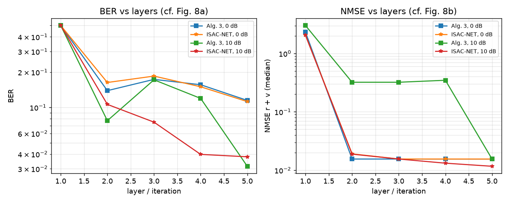
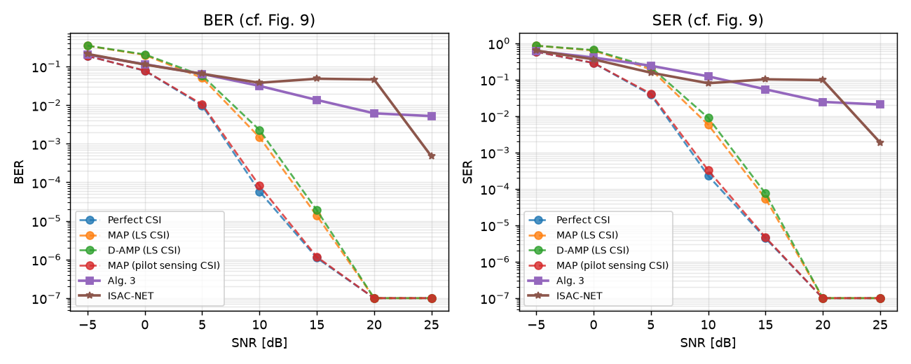

# ISAC-NET run status

**Updated:** 2026-10-26 12:57 AM IST

_If this time stops moving, the Mac run has stopped (or the Mac is offline/asleep)._

**State:** FINISHED

## Stages started
```
== baselines (NumPy, on 12 CPU cores) ==
== train ISAC-NET (inner4) ==
== evaluate (inner4) ==
== train ISAC-NET (literal) ==
== evaluate (literal) ==
```

## Errors
```
(none)
```

## Last log lines
```
alg3     SNR   0.0 BER 1.15e-01 SER 4.06e-01 NMSE r 7.6e-02 (med 8.1e-08) v 5.4e-01 (med 1.6e-02)
alg3     SNR   5.0 BER 6.42e-02 SER 2.42e-01 NMSE r 5.5e-02 (med 8.1e-08) v 4.9e-01 (med 1.6e-02)
alg3     SNR  10.0 BER 3.15e-02 SER 1.24e-01 NMSE r 1.2e-01 (med 8.1e-08) v 1.2e+00 (med 1.6e-02)
alg3     SNR  15.0 BER 1.36e-02 SER 5.44e-02 NMSE r 1.4e-01 (med 8.1e-08) v 8.5e-01 (med 1.2e-02)
alg3     SNR  20.0 BER 6.14e-03 SER 2.45e-02 NMSE r 9.5e-02 (med 8.1e-08) v 8.0e-01 (med 1.2e-02)
alg3     SNR  25.0 BER 5.20e-03 SER 2.08e-02 NMSE r 5.3e-02 (med 8.1e-08) v 4.1e-01 (med 1.2e-02)
isacnet  SNR  -5.0 BER 2.11e-01 SER 6.32e-01 NMSE r 1.8e-01 (med 1.4e-02) v 8.2e-01 (med 7.6e-02)
isacnet  SNR   0.0 BER 1.12e-01 SER 3.63e-01 NMSE r 8.7e-02 (med 1.7e-06) v 5.0e-01 (med 1.6e-02)
isacnet  SNR   5.0 BER 6.46e-02 SER 1.56e-01 NMSE r 1.9e-01 (med 8.1e-08) v 5.2e-01 (med 1.5e-02)
isacnet  SNR  10.0 BER 3.79e-02 SER 8.00e-02 NMSE r 6.4e-02 (med 8.1e-08) v 4.1e-01 (med 1.2e-02)
isacnet  SNR  15.0 BER 4.83e-02 SER 1.03e-01 NMSE r 6.6e-02 (med 8.1e-08) v 2.4e-01 (med 1.2e-02)
isacnet  SNR  20.0 BER 4.61e-02 SER 9.72e-02 NMSE r 5.5e-02 (med 8.1e-08) v 5.0e-01 (med 1.2e-02)
isacnet  SNR  25.0 BER 4.69e-04 SER 1.87e-03 NMSE r 6.5e-03 (med 8.1e-08) v 6.8e-02 (med 1.2e-02)
wrote results/fig_gpu_literal_{8,9,10}.png
done: results/fig_gpu_*
```

## Result files
```
Oct 26 00:52 results/fig_gpu_literal_8.png
Oct 26 00:52 results/fig_gpu_literal_10.png
Oct 26 00:52 results/fig_gpu_literal_9.png
Oct 26 00:52 results/isacnet_gpu_literal.json
Oct 26 00:29 results/eta_gpu_literal.json
Oct 25 22:55 results/fig_gpu_inner4_8.png
Oct 25 22:55 results/fig_gpu_inner4_10.png
Oct 25 22:55 results/fig_gpu_inner4_9.png
Oct 25 22:54 results/isacnet_gpu_inner4.json
Oct 25 22:29 results/eta_gpu_inner4.json
Oct 25 20:38 results/baselines_full_gpu.png
Oct 25 20:38 results/baselines_full_gpu.json
```

### fig_gpu_inner4_10.png


### fig_gpu_inner4_8.png


### fig_gpu_inner4_9.png


### fig_gpu_literal_10.png


### fig_gpu_literal_8.png


### fig_gpu_literal_9.png

