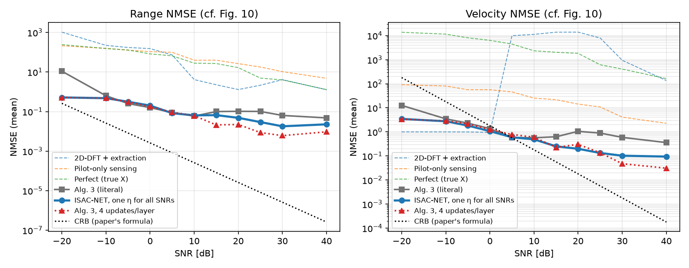
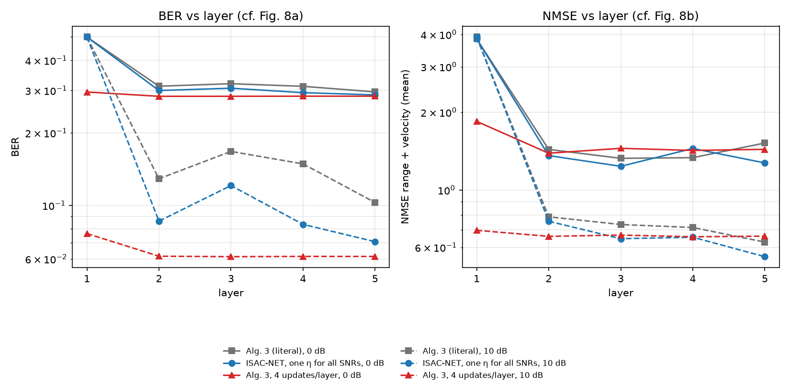
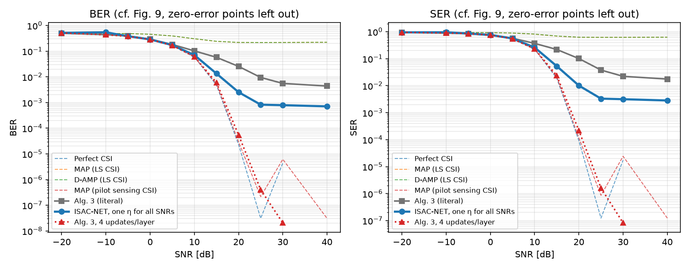

# ISAC-NET run status (random-target check of the lower-lr eta)

**Updated:** 2026-10-31 06:48 PM IST

_If this time stops moving, the Mac run has stopped (or the Mac is offline/asleep)._

**State:** RUNNING (pid 80490, elapsed 40:31)

## Stages started
```
== evaluate literal, random targets ==
```

## Errors
```
(none)
```

## Last log lines
```
alg3     SNR   0.0 BER 2.99e-01 SER 7.49e-01 NMSE r 1.1e-01 (med 9.8e-06) v 6.2e-01 (med 1.9e-02)
alg3     SNR   5.0 BER 1.85e-01 SER 5.78e-01 NMSE r 5.8e-02 (med 2.8e-06) v 3.1e-01 (med 1.3e-02)
alg3     SNR  10.0 BER 1.06e-01 SER 3.79e-01 NMSE r 4.0e-02 (med 2.7e-06) v 2.1e-01 (med 7.2e-03)
alg3     SNR  15.0 BER 6.18e-02 SER 2.35e-01 NMSE r 5.5e-02 (med 4.3e-06) v 3.4e-01 (med 8.6e-03)
alg3     SNR  20.0 BER 3.46e-02 SER 1.37e-01 NMSE r 9.9e-02 (med 3.0e-06) v 5.1e-01 (med 8.4e-03)
alg3     SNR  25.0 BER 1.90e-02 SER 7.58e-02 NMSE r 1.1e-01 (med 2.4e-06) v 4.0e-01 (med 8.8e-03)
alg3     SNR  30.0 BER 1.49e-02 SER 5.96e-02 NMSE r 8.7e-02 (med 3.0e-06) v 4.1e-01 (med 9.4e-03)
isacnet  SNR   0.0 BER 2.90e-01 SER 7.62e-01 NMSE r 9.2e-02 (med 8.1e-06) v 8.8e-01 (med 1.6e-02)
isacnet  SNR   5.0 BER 1.75e-01 SER 5.68e-01 NMSE r 6.2e-02 (med 2.9e-06) v 3.3e-01 (med 1.2e-02)
isacnet  SNR  10.0 BER 7.50e-02 SER 2.78e-01 NMSE r 5.1e-02 (med 2.5e-06) v 2.1e-01 (med 7.5e-03)
isacnet  SNR  15.0 BER 2.18e-02 SER 8.07e-02 NMSE r 5.4e-02 (med 3.1e-06) v 2.4e-01 (med 6.6e-03)
isacnet  SNR  20.0 BER 6.44e-03 SER 2.55e-02 NMSE r 6.7e-02 (med 2.0e-06) v 3.0e-01 (med 6.0e-03)
isacnet  SNR  25.0 BER 4.41e-03 SER 1.76e-02 NMSE r 3.8e-02 (med 1.6e-06) v 2.4e-01 (med 6.1e-03)
isacnet  SNR  30.0 BER 4.40e-03 SER 1.76e-02 NMSE r 4.8e-02 (med 2.2e-06) v 2.3e-01 (med 6.0e-03)
done: results/isacnet_paper_lr_randtargets.json
```

## Result files
```
Oct 31 18:39 results/isacnet_paper_lr_randtargets.json
```

### paper_lr_fig10.png


### paper_lr_fig8.png


### paper_lr_fig9.png

