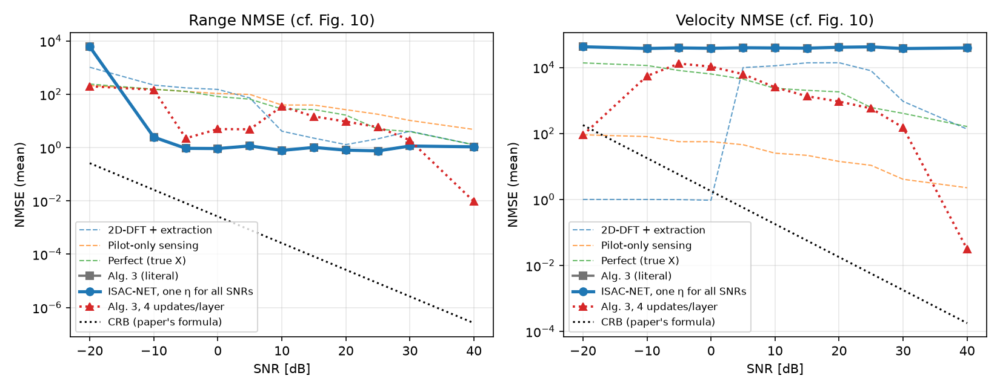
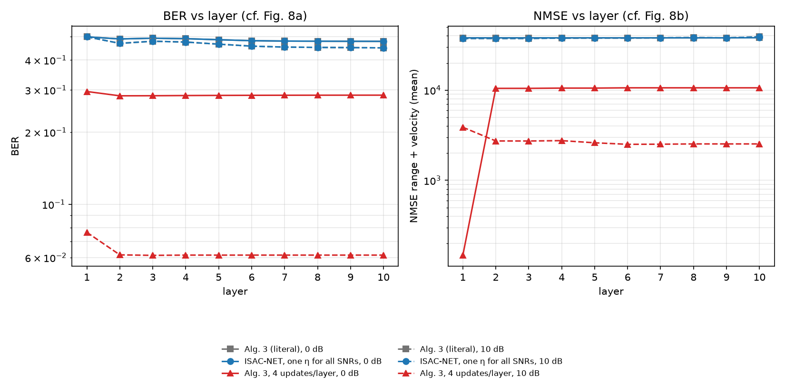
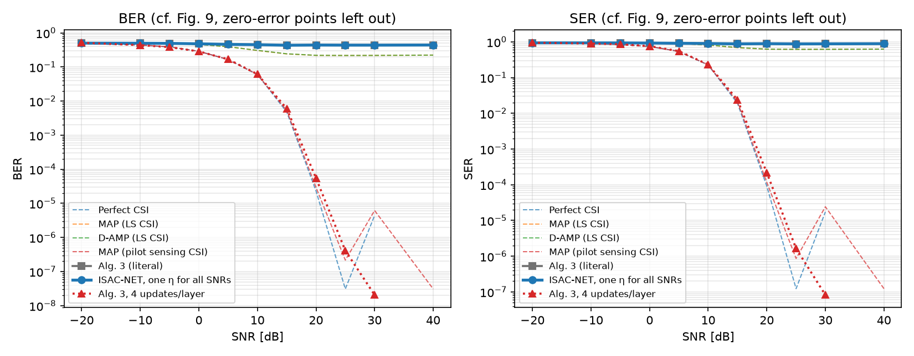
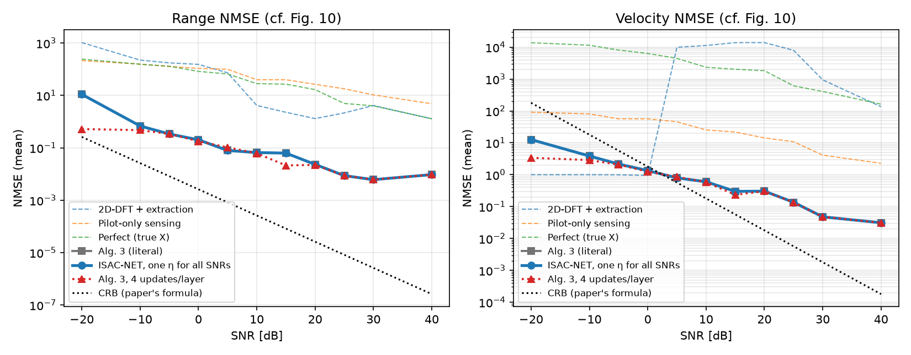
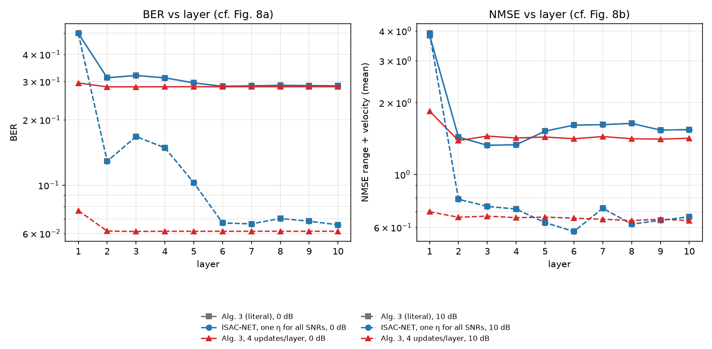
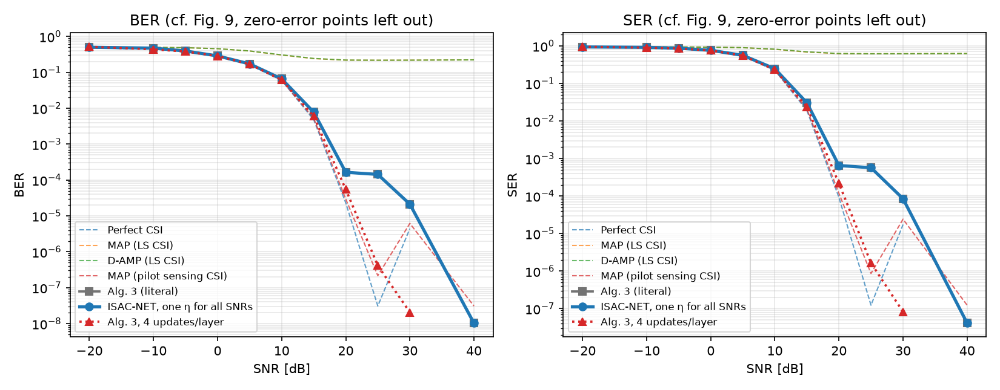

# ISAC-NET run status (paper setup: combined SNR, -20..40 dB, 10 layers)

**Updated:** 2026-10-28 11:07 PM IST

_If this time stops moving, the Mac run has stopped (or the Mac is offline/asleep)._

**State:** FINISHED

## Stages started
```
== baselines ==
== train ISAC-NET (literal, one eta for all SNRs, 10 layers) ==
== evaluate literal ==
== evaluate Alg. 3 with 4 updates per layer ==
== evaluate with the search window ==
```

## Errors
```
(none)
```

## Last log lines
```
2090/2200
2200/2200
alg3     SNR -20.0 BER 5.15e-01 SER 9.47e-01 NMSE r 5.2e-01 (med 3.0e-01) v 3.4e+00 (med 2.5e+00)
alg3     SNR -10.0 BER 4.36e-01 SER 8.95e-01 NMSE r 4.7e-01 (med 2.5e-01) v 2.9e+00 (med 2.2e+00)
alg3     SNR  -5.0 BER 3.79e-01 SER 8.51e-01 NMSE r 3.4e-01 (med 1.7e-01) v 2.1e+00 (med 1.1e+00)
alg3     SNR   0.0 BER 2.84e-01 SER 7.54e-01 NMSE r 1.8e-01 (med 1.6e-02) v 1.2e+00 (med 3.4e-01)
alg3     SNR   5.0 BER 1.68e-01 SER 5.49e-01 NMSE r 1.0e-01 (med 4.8e-06) v 8.5e-01 (med 1.6e-02)
alg3     SNR  10.0 BER 6.14e-02 SER 2.30e-01 NMSE r 6.1e-02 (med 8.1e-08) v 5.8e-01 (med 1.6e-02)
alg3     SNR  15.0 BER 5.99e-03 SER 2.36e-02 NMSE r 2.1e-02 (med 8.1e-08) v 2.3e-01 (med 1.2e-02)
alg3     SNR  20.0 BER 5.47e-05 SER 2.17e-04 NMSE r 2.2e-02 (med 8.1e-08) v 3.0e-01 (med 1.2e-02)
alg3     SNR  25.0 BER 4.12e-07 SER 1.65e-06 NMSE r 8.6e-03 (med 8.1e-08) v 1.4e-01 (med 1.2e-02)
alg3     SNR  30.0 BER 2.06e-08 SER 8.24e-08 NMSE r 6.1e-03 (med 8.1e-08) v 4.8e-02 (med 1.2e-02)
alg3     SNR  40.0 BER 0.00e+00 SER 0.00e+00 NMSE r 9.5e-03 (med 8.1e-08) v 3.1e-02 (med 1.2e-02)
wrote results/paper_window_fig{8,9,10}.png
done: results/paper_fig{8,9,10}.png, results/paper_window_fig{8,9,10}.png
```

## Result files
```
Oct 28 22:59 results/paper_window_fig8.png
Oct 28 22:59 results/paper_window_fig10.png
Oct 28 22:59 results/paper_window_fig9.png
Oct 28 22:59 results/isacnet_paper_inner4_window.json
Oct 28 22:18 results/isacnet_paper_literal_window.json
Oct 28 20:55 results/paper_fig8.png
Oct 28 20:55 results/paper_fig10.png
Oct 28 20:55 results/paper_fig9.png
Oct 28 20:55 results/isacnet_paper_inner4.json
Oct 28 20:12 results/isacnet_paper_literal.json
Oct 28 18:47 results/eta_paper_literal.json
Oct 28 16:30 results/baselines_paper.png
Oct 28 16:30 results/baselines_paper.json
```

### paper_fig10.png


### paper_fig8.png


### paper_fig9.png


### paper_window_fig10.png


### paper_window_fig8.png


### paper_window_fig9.png

